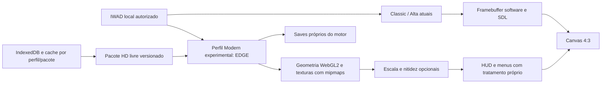

# Discovery — resolução, nitidez e materiais modernos

Data: **25/10/2026**. Base examinada: release **0.3.0**, commit `d73fac9537469c64ad7186cde456f58a9481b3ef`. Coordenação: `doom_director`; análises independentes de rendering, arte e plataforma. Este documento registra investigação e plano técnico. Um renderer novo e pacotes HD ainda precisam de protótipo executado neste projeto.

> Histórico: após este discovery, o usuário priorizou qualidade visual sem orçamento artificial de tamanho/CPU/memória. Os orçamentos de 20 MiB/64 MiB abaixo são propostas históricas substituídas. A implementação e suas provas estão em [Moderno HD 0.4.0](../modern-hd/RELEASE.md).

## Parecer executivo

O caminho que ataca conjuntamente contornos e detalhe de superfície é **renderizar a geometria na GPU, em resolução ajustável, e carregar texturas de maior definição com filtragem adequada**. Aumentar somente o Canvas ou aplicar sharpening ao quadro 640×400 não entrega esses dois ganhos.

Recomendação: testar **EDGE-Classic/WebGL2 em uma thread** como um perfil visual adicional, começando com uma cena de Freedoom e um pacote pequeno de texturas livres. Há suporte web no próprio upstream e um [player oficial](https://edge-classic.github.io/play.html); a análise de código identifica substituição de imagens HD e mipmaps. Isso o torna o primeiro candidato a prototipar, sem comprovar ainda a integração com nossos controles, saves ou o Chrome no iPad. A comparação completa e revisões consultadas estão em [RENDERERS.md](RENDERERS.md).

O primeiro objetivo é **HD com boa amostragem**, e não um conjunto completo de efeitos AAA. A auditoria dos caminhos web consultados não comprovou PBR pronto para uso: o shader de mundo do EDGE examinado não implementa o conjunto normal/roughness/metalness, e o fork UZDoom-WASM examinado força o material normal no backend GLES. Materiais PBR exigem outra entrega de engenharia, mesmo quando arquivos relacionados existem no repositório.

Há um gate anterior à adoção do EDGE: seu build web consultado configura **512 MiB de heap inicial**, contra 32 MiB iniciais e teto de 256 MiB na base atual. Esses números não são consumo residente medido. O protótipo deve medir alocações e verificar uma configuração menor; se isso não for sustentável no dispositivo-alvo, rever o candidato. O player upstream também usa clique/Pointer Lock, fluxo que precisa ser substituído pela nossa ponte de teclado. Os assets de suporte têm licenças distintas, inclusive conteúdo não comercial: auditar e recortar o conjunto necessário antes de redistribuir.

Manter Chocolate 320×200 e Crispy 640×400 disponíveis. Um novo motor recebe identidade e saves próprios; não presumir conversão de saves entre famílias de motores.

## O que causa a aparência pixelada agora

| Camada | Evidência na base atual | O que melhora essa camada |
|---|---|---|
| Cena/contornos | Crispy rasteriza 640×400; limites e escalas foram projetados para `hires` 0/1 | Outro renderer escalável, com resolução interna medida |
| Texturas | Imagens do IWAD continuam com seus texels originais | Substituições HD com dimensões lógicas/UV preservadas |
| Arma, inimigos e HUD | Sprites e patches também mantêm a definição original | Trabalho específico de arte; HD do cenário não os converte em modelos 3D |
| Distância e ângulos rasantes | Piso e teto apresentam padrões finos na captura existente | Mipmaps e filtragem trilinear; investigar anisotropia quando o backend oferecer |
| Escala até a tela | Nítido usa `image-rendering: pixelated`; Suave usa interpolação do browser | Escolher filtro conscientemente e evitar reamostragem duplicada |
| Contraste de materiais | Renderização paletizada, iluminação clássica e ausência de mapas PBR no perfil atual | Shader/material novo e direção de arte; brilho de tela não é iluminação de mundo |

A [captura Alta da 0.3.0](../hires-evidence/high.png) mostra contornos geométricos mais definidos, mas pixels grandes na arma e no HUD e repetição/padrões finos no piso. Isso é inspeção de uma imagem estática: não mede cintilação em movimento, conforto, FPS ou desempenho em dispositivo.

O framebuffer interno 640×400 é apresentado em 4:3; o Canvas SDL observado é 640×480. Um filtro aplicado depois do SDL já recebe a correção de aspecto. Para filtros sensíveis à vizinhança dos texels, especificar se a entrada será o buffer original ou a imagem corrigida. Não filtrar indiscriminadamente ambas as etapas.

## Caminhos comparados

| Caminho | Ganho esperado | Custo e limite | Parecer |
|---|---|---|---|
| Shader de nitidez na versão atual | Contraste local e escala mais controlada | Continua 640×400, sem texturas novas; pode acentuar serrilhado e halos | Experimento curto e opcional |
| Aumentar constantes do Crispy | Mais amostras, se todo o pipeline for adaptado | Buffers, limites, escalas e HUD precisam de revisão; não é só mudar `MAXHEIGHT` | Não priorizar esse fork próprio |
| Woof/DSDA em software | Resolução escalável, preservando um caminho de software | Outro port/integrador; maior resolução não resolve a definição dos assets | Alternativa caso o objetivo seja aparência clássica em mais pixels |
| **EDGE-Classic/WebGL2** | Geometria acelerada, resolução ajustável, imagens HD e filtros | Rever heap inicial upstream de 512 MiB e assets; integrar entrada, ciclo de vida, áudio, offline e saves | **Primeiro protótipo recomendado, sujeito ao gate de memória** |
| GZDoom/UZDoom-WASM | Ecossistema amplo de mods e materiais no desktop | Forks web têm diferenças de APIs, threads, memória e materiais; funcionalidade desktop não prova suporte web | Segunda investigação para requisitos que o EDGE não atender |
| Renderer próprio em WebGL2 | Controle integral dos materiais | Reimplementar projeção/visibilidade, sprites, efeitos e casos especiais | Adiar; custo e risco maiores |
| WebGPU/ray tracing | Possibilidades futuras | APIs e hardware distintos; não são pré-requisito para HD nítido | Fora da primeira fatia |

WebGPU já foi anunciado para iOS/iPadOS no Safari 26; não é correto tratá-lo como inexistente. A capacidade efetiva no Chrome do dispositivo precisa ser detectada e testada. WebGL2 é a escolha inicial por corresponder ao backend do candidato, sem impor WebGPU. Ver [plataforma e fontes oficiais](PLATFORM.md).

## Filtros: o que testar e o que eles não resolvem

| Técnica | Uso adequado | Risco / decisão |
|---|---|---|
| Nearest / escala por pixels | Preservar pixel art e texto original | Mantém blocos visíveis; manter como opção Classic |
| Bilinear | Transições suaves de ampliação | Em baixa resolução pode parecer desfocado; não chamar de novo detalhe |
| Escala inteira + ajuste final suave | Reduzir irregularidade em escalas fracionárias | Mantém a informação de origem e pode exigir margem/corte; validar aspecto e HUD |
| xBR/xBRZ | Reconstrução estilizada de bordas de pixel art | Pode alterar letras, rostos e textura; avaliar primeiro em assets isolados, não como padrão de todo o mundo |
| Mipmaps + trilinear | Texturas reduzidas pela perspectiva | Reduzem aliasing de textura à distância; precisam existir no renderer de mundo |
| Anisotropia | Pisos/paredes vistos em ângulo | Consultar extensão/limite e backend; suporte não comprovado no EDGE examinado |
| MSAA / FXAA / SMAA | Contornos geométricos ou pós-processamento de bordas | Não criam detalhe de textura. Pós-processamento pode afetar HUD; comparar cena separadamente |
| CAS / RCAS moderado | Recuperar contraste local após amostragem | Pode criar halos e amplificar ruído. Exigir intensidade ajustável e desligamento |
| FSR 1 | Upscale espacial com entrada já bem amostrada/anti-aliased | SDK desktop não é um passe WebGL pronto; exige adaptação e validação. Não é o primeiro remédio para 320×200/640×400 sem AA |
| Reconstrução temporal / geração de frames | Pipelines com histórico, profundidade e outros dados exigidos pela técnica | A ponte atual fornece apenas uma imagem; não há integração demonstrada. Não priorizar |

A documentação de [FSR 1 da AMD](https://gpuopen.com/manuals/fidelityfx_sdk/techniques/super-resolution-spatial/) pede entrada com antialiasing, normalizada e sem ruído; recomenda composição antes da UI. [CAS](https://gpuopen.com/fidelityfx-cas/) trata nitidez adaptativa. São referências para experimentos, sem promessa de qualidade/performance neste jogo. O [shader xBRZ examinado](https://github.com/libretro/glsl-shaders/blob/master/xbrz/shaders/6xbrz.glsl) contém avisos MIT e GPLv3: fixar a revisão e preservar todas as obrigações se for incorporado; não presumir licença uniforme de uma coleção.

## O que aproveitar dos jogos modernos

O estudo primário de [DOOM Eternal/idTech 7, SIGGRAPH 2020](https://advances.realtimerendering.com/s2020/index.html) discute composição de materiais, decals, geometria e otimização. A apresentação [idTech 8, SIGGRAPH 2025](https://www.advances.realtimerendering.com/s2025/index.html) aborda iluminação global em tempo real. Essas referências sustentam a separação entre conteúdo, materiais, iluminação e orçamento; não fornecem um renderer pronto para este port. A leitura do programa/resumo foi realizada; os slides completos de DOOM Eternal não foram recuperados nesta sessão.

Aplicar os princípios em uma escala menor:

- **Detalhe coerente por superfície:** metal, concreto e piso com definição consistente, sem uma textura hiper-realista isolada entre sprites originais.
- **Materiais por função:** cor base, normal, rugosidade, metalicidade e emissão são informações diferentes. Arquivos PBR só produzem esses efeitos quando o shader os interpreta.
- **Amostragem correta:** mipmaps, filtragem, espaço de cor e escala física/UV importam tanto quanto o tamanho do PNG.
- **Detalhe localizado:** 512² como candidato para superfícies principais, 256² para pequenas e 1024² somente quando a comparação justificar o custo. Não iniciar com todas as superfícies em 4K.
- **Legibilidade antes de efeito:** preservar silhuetas, contraste de ameaças, portas e itens; HUD não deve receber blur/bloom para esconder os pixels.

Materiais CC0 de [Poly Haven](https://polyhaven.com/license) e [ambientCG](https://docs.ambientcg.com/license/) permitem construir uma fatia com procedência verificável. A seleção concreta, os nomes encontrados no E1M1 livre e o pipeline estão em [TEXTURES.md](TEXTURES.md). São candidatos de conteúdo; nenhum pack foi integrado.

Não incorporar o Freedoom-HD completo como primeira entrega: o asset consultado tem **402.969.291 bytes (~384,3 MiB)**, contra **33.901.225 bytes (~32,33 MiB)** de recursos da medição anterior da 0.3.0. O download é cerca de 12 vezes esse conjunto, e não representa o uso de memória após descompressão. DHTP exige conferência de crédito e licença por imagem; um download público não estabelece permissão uniforme. Os detalhes e links de procedência estão no relatório de arte.

## Arquitetura proposta para o protótipo

É um desenho de integração a validar, incluindo a possibilidade de compor HUD separadamente; não descreve código que já foi implementado no EDGE web. O aplicativo atual aceita apenas IWAD de DOOM 1/Freedoom Phase 1. Carregar PK3/EPK/PNG exige outro validador e fluxo de conteúdo; mudar a extensão aceita no seletor não implementa suporte.

Identificar os assets por hash do IWAD, nome lógico, escala e hash do pacote. Manter texturas comerciais importadas locais. Pacotes devem ter manifestos, limites de bytes/imagens/dimensões, validação de caminhos e descompressão, procedência e fallbacks. Não habilitar scripts arbitrários de um pacote sob o rótulo de “texturas”. A preparação offline precisa incluir motor, decodificadores e o pacote escolhido, com atualização e confirmação de completude.

GPLv3 dos candidatos exige revisar o artefato combinado e sua fonte correspondente antes de distribuir. A base GPL-2.0-or-later permite avaliar essa combinação, mas não autoriza ignorar créditos/licenças de dependências ou alterar os avisos dos backends existentes. Não remover os namespaces de dados atuais.

## Plano executável e critérios de avanço

| Ordem | Trabalho e responsáveis | Prova necessária para avançar |
|---|---|---|
| D1 | Plataforma + rendering: fixar EDGE/fontes/toolchain; build próprio singlethread na nuvem | WASM compilado, WebGL2 real, E1M1 renderizado e licenças completas; medir/rever os 512 MiB iniciais, auditar assets de suporte e não depender do site de terceiros |
| D2 | Gameplay + plataforma: portar bridge de teclado, giro, menus, pausa, áudio | WASD+setas simultâneos, foco/perda de foco e áudio; nenhuma dependência de Pointer Lock/clique durante o jogo; auto-aim e sem pulo/mira livre |
| D3 | Rendering + QA: resolução ajustável e escala correta | Metas de saída 4:3: 960×720 para comparação leve, 1280×960 inicial e 1600×1200 opcional. Registrar viewport de mundo, FOV, aspecto, HUD e draw buffer reais, sem afirmar 1280×800 como capacidade do candidato |
| D4 | Arte + rendering: uma cena, 8–12 substituições livres | Mesma câmera/cena, antes/depois, dimensões lógicas, sem costuras/halos, leitura do HUD e sprites; inventário de autores/licenças/hashes |
| D5 | Rendering: mipmaps/trilinear; investigar AA e nitidez moderada | Imagens e movimento comparáveis; efeito desativável; custo por opção medido. Anisotropia só após demonstrar suporte |
| D6 | Plataforma + QA: perfil e saves próprios, backups e preparação offline | Save/load/reabertura sem rede; troca segura de perfil e preservação byte a byte dos saves Classic/Alta; erro/quota/update interrompido cobertos |
| D7 | QA independente + usuário: regressão e dispositivo | Chromium/WebKit automatizados e Chrome no iPad real, sessão sustentada e checklist de teclado/áudio/offline |
| D8 | Rendering + arte: PBR limitado a uma superfície, se ainda necessário | Provar suporte ou implementar shader+normais/UV/tangentes/luz; medição e comparação com albedo HD antes de produzir um pack PBR |

As dimensões acima são **metas de apresentação**, não resultados. O Crispy usa pixels não quadrados com correção 4:3; um renderer GPU pode trabalhar diretamente com pixels quadrados. Comparar 1280×800 legado corrigido com 1280×960 exige especificar projeção e aspecto, não comparar apenas os números. Não forçar widescreen nem esticar o quadro.

Propostas iniciais de orçamento, sujeitas ao baseline do protótipo: pacote da primeira cena até **20 MiB de download adicional**, texturas GPU residentes até **64 MiB** nessa cena e perfil de resolução inferior disponível. Uma fatia de 12 materiais com três mapas RGBA8 512² e mipmaps ocupa aproximadamente **48 MiB apenas nas texturas**; um protótipo só com albedo exige menos. Compressão, cache de disco, heap WASM e memória GPU são grandezas diferentes. Ver contas e exclusões em [PLATFORM.md](PLATFORM.md).

Medir tempos de frame p50/p95/p99, inicialização fria/quente, long tasks, tamanho do download/cache e memória observável na mesma cena. Metas de 60 Hz/30 Hz só podem ser classificadas após testes; a simulação continua separada em 35 tics/s. Custo sustentado, energia e latência Bluetooth precisam do dispositivo. Não há estimativa de prazo fechada antes do build e do gate D2.

## Estado da investigação

**Verificado nesta etapa:** inspeção dos fontes locais e da captura existente; consulta a fontes primárias; análise independente de três especialidades; comparação de backends, assets, licenças e orçamentos teóricos. Dados da release anterior estão identificados como anteriores.

**Ainda sem validação:** build próprio do novo candidato, suas texturas HD em execução neste app, PBR web efetivo, ganhos de FPS, memória total, qualidade subjetiva e Chrome no iPad físico. O player de outro projeto e sua documentação são evidência de um caminho disponível, não teste do nosso jogo.

Os arquivos de runtime, binários e configurações de dados da versão jogável não são modificados por este discovery. A próxima fatia técnica definida é D1–D4, com gates para rever o candidato caso a integração não atenda teclado, desempenho ou offline.

Revisão independente documental (`doom_platform`): nenhum crítico/alto; dois apontamentos médios corrigidos na consolidação (tornar o heap inicial do candidato um gate explícito e harmonizar metas de resolução) e um baixo corrigido (retirar comparação absoluta sem protótipo). A revisão é de arquitetura e documentação; não substitui QA do futuro runtime.
