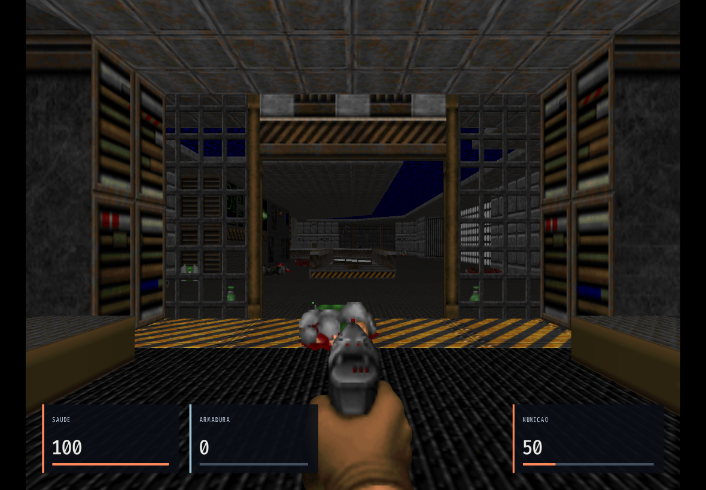
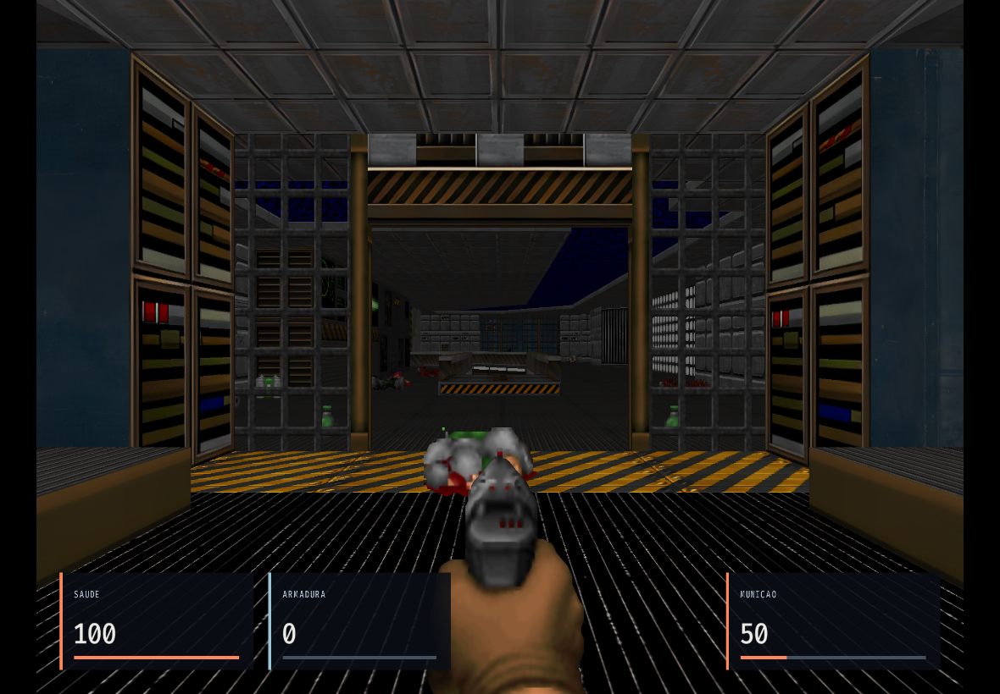

# Moderno HD — versão 0.4.0

O objetivo desta entrega é design moderno e alta resolução real no browser, priorizando qualidade visual sem os orçamentos artificiais de download, CPU e memória propostos no discovery. A base Classic continua disponível com seus dados preservados. Chrome no iPad é um perfil de uso, e não uma implementação nativa ou uma validação física já realizada.

## O que muda

- **Geometria na GPU:** EDGE-Classic compilado de C/C++ para WASM/WebGL2, em uma thread, no lugar do rasterizador em software quando Moderno é selecionado. Não é um clone JavaScript nem apenas ampliação de Canvas.
- **1920×1440 por padrão:** opções 1280×960, 1920×1440, 2560×1920 e 3840×2880, mantendo 4:3 com pixels quadrados. O drawing buffer é independente da dimensão CSS da página.
- **1.115 imagens HD:** 877 texturas e 238 pisos/tetos compatíveis com Freedoom Phase 1 0.13.0. São 1.113 imagens reconstruídas em 4× e dois materiais fotográficos CC0 da Poly Haven em 4096×4096, destinados às superfícies BASE2 e FLAT1. Mipmaps/trilinear e suavização usam as texturas antes da projeção. [Procedência e exclusões](CONTENT.md).
- **HUD contemporâneo nativo:** vida e munição vêm do estado autoritativo do motor. Configurações permitem a barra clássica; HUD é apresentação, sem cálculo paralelo de dano/munição em JavaScript.
- **Launcher redesenhado:** carvão/aço/laranja, tipografia ampla, menu de teclado, foco explícito, layout responsivo e ilustração vetorial original. [Direção visual e inspeção](DESIGN.md).
- **Teclado e áudio:** WASD, giro contínuo por setas com a rampa C existente, tiro, interação, menus e saves; Enter retoma áudio/partida. O host controla foco/suspensão, sem Pointer Lock ou clique obrigatório durante o jogo.
- **Perfis e persistência:** Moderno tem saves próprios do EDGE. Backups v3 incluem os três perfis; importação v1/v2 é preservada. Os bancos/IDs antigos permanecem. Não copiamos `.dsg` para o motor novo.
- **Offline completo:** loaders, três WASMs, dados mínimos do EDGE, pacote HD, conteúdo livre e interface entram no cache versionado. Fontes correspondentes ficam disponíveis em download separado.

Uma instalação nova seleciona Moderno; preferências salvas anteriormente mantêm a escolha. O pacote HD só é aplicado ao hash exato do Freedoom compatível. Um WAD importado com outro hash usa suas próprias imagens locais, mesmo que tenha nomes de texturas coincidentes.

## Como jogar

Abra [DOOM Classic Browser](https://adhenawer.github.io/Doom-classic-browser/) com conexão e teclado. Em instalação existente: **Configurações → Resolução do motor → Moderno HD**, selecione a resolução e salve. Se houver uma partida ativa, salve no motor antes de **Aplicar nova resolução → Aplicar resolução e reiniciar**. Progresso não salvo não é convertido em save automaticamente.

Para teclado exclusivo em um tablet, selecione **Controles → Experiência de controles → Teclado · sem controles na tela**; a escolha é persistente. Use Jogar e Enter para retomar. WASD move, setas giram, J atira, Espaço/E interage, P abre o menu, K salva, L carrega e H retorna ao launcher. Menus e configurações funcionam por teclado. A seleção inicial de IWAD e importação/exportação de backup podem abrir interfaces nativas do navegador.

Para offline, mantenha a página aberta até concluir **Preparado para offline neste contexto**. O pacote é grande; prepare o contexto exato de aba/PWA que pretende usar. Depois teste reabertura sem conexão, carregue uma partida e confirme áudio/teclado. O browser pode remover dados; exporte backups. Essa limitação física não é um orçamento de produto.

## Fontes, licenças e reprodutibilidade

EDGE-Classic: revisão `9e2b61677f215861e40b631429bf322935e8f87c`; archive de 23.559.129 bytes, SHA-256 `fd67f6a9da631c870ca8b1212d412a6f699e9508fb275754d3af116f5ff8a83c`, GPL-3.0-or-later. A adaptação acontece em uma cópia descartável; a fonte upstream permanece íntegra. Toolchain Emscripten 4.0.18 fixada por digest, CMake 3.31.6 fixado e dependências npm exatas com lock.

O build web upstream é adaptado para o contrato DOM/IDBFS do produto: sem mount/sync concorrente, sem Pointer Lock, eventos SDL de teclado duplicados ignorados, relógio de suspensão, configuração limitada de câmera/regras e notificações após salvar. Suporte pré-carregado contém somente definições necessárias a DOOM/Freedoom, arquivos do Freedoom e soundfont com seus avisos; não copia gráficos comerciais ou packs de outros jogos.

A combinação do backend Moderno observa GPLv3 e distribui `EDGE-COPYING.txt`, `EDGE-NOTICES.txt` e fontes correspondentes, preservando os avisos dos componentes e a licença dos backends anteriores. Imagens Freedoom derivadas têm termos BSD próprios; licença de engine não é licença de assets. [Inventário de conteúdo](CONTENT.md).

O gerador do EPK reproduziu duas vezes o mesmo checksum. Não se presume identidade byte a byte dos binários WASM entre executores sem comparação específica. O pacote lógico HD tem **398.681.345 bytes (~380,21 MiB)** e é entregue em **12 partes de até 32 MiB**, sem reduzir imagens ou alterar seus bytes. Cada parte tem tamanho, offset e SHA-256 fixados; o host verifica cada resposta antes de montar o EPK em MEMFS. A medição histórica abaixo identifica os 38 recursos da base anterior; a integração atual contém 42 recursos, incluindo Aurora e Mobile, separados da fonte correspondente.

## Validação

**Candidata de áudio em validação:** 32 testes Node aprovados; regressão real de política de áudio aprovada em Chromium e WebKit. O próximo gate terá 44 cenários. O [CI 17b8bcc](https://github.com/adhenawer/Doom-classic-browser/actions/runs/40245749591) aprovou 41/42, incluindo a carga HD que falhava anteriormente, mas bloqueou a publicação por uma chamada de áudio não solicitada antes de abrir Configurações. A nova correção elimina esse listener global e agrupa transições repetidas, mantendo os gestos explícitos. Build local `1cf64351aeed820c`, WASM `67415a9d2222c5895b8dba11132f2bf0a238bea72803d696d2a6be3785f9b10c`, 42 recursos; gate integral pendente.

**Integração final em validação:** o [CI 9bde476](https://github.com/adhenawer/Doom-classic-browser/actions/runs/40242060865) aprovou 41/42 cenários e bloqueou a publicação por uma espera de menu no segundo boot Moderno WebKit. A análise confirmou um anúncio de pronto antes do retorno do primeiro quadro/tick. A nova candidata exige RenderView, swap e tick completos, observados/suspensos no mesmo turno JavaScript; o novo gate ainda está pendente.

 22 testes Node, sete testes Python do mapa e três executáveis C aprovados (rotação e filas reais Clássica/Alta). A suíte integrada passa a ter **42 cenários** após preservar Aurora/Mobile e adicionar a regressão de gravações concorrentes em IndexedDB. O artefato da primeira rodada integrada é `ea850db4fedd2174`, com 42 recursos e WASM Moderno `d62adb907732032152ddf52a63d558f4232f00262fff030f1b19a3d4013d3e73`.

O [primeiro CI da implementação](https://github.com/adhenawer/Doom-classic-browser/actions/runs/40235114291), sobre `55dec9d`, aprovou os três builds e 23/28 cenários, bloqueando a publicação após cinco falhas. As correções incluem aguardar carregamento nativo, preservar a primeira tecla após fechar menu, fila de eventos suficiente para o lote de 64 eventos de um save e fallback de fonte adequado. O gate completo será repetido na integração atual. Uma regressão adicional mantém duas transações reais do IndexedDB pendentes: o launcher deve sinalizar gravação em andamento e só confirmar a geração mais recente após seu commit, com snapshots independentes. O mesmo teste falhou causalmente na base anterior, antes da correção. As oito validações Moderno e medições abaixo identificam explicitamente a versão anterior `16f3315a5e696112`; não substituem o resultado final dos 42 casos.

O Chromium usa perfis normais em disco. O WebKit usa contexto isolado padrão porque o modo persistente do runner WPE perdeu até uma gravação sintética de cinco bytes em um probe independente. A prova WebKit vale para reload/offline dentro da sessão, sem certificar durabilidade entre processos. Um ensaio atingiu forte pressão do limite de 16 GiB e travou ao abrir Configurações; o mesmo fluxo passou em repetição fresca sem reduzir recursos. A causa absoluta permanece indeterminada.

A [revisão independente](QA.md) registra evidências, problemas encontrados e retestes. Nenhum resultado de Chromium/WebKit Linux é apresentado como teste físico do Chrome no iPad. PCM não nulo demonstra geração de áudio, sem certificar percepção sonora/latência.

## Provas de resolução e imagem

[Dados completos da medição](evidence/measurement.json), artefato local `16f3315a5e696112`, WASM SHA-256 `1b9f6e3eb39e5ef870f4a59890448f3c4edb51ff4b42da2ad27995dd45ea1b8c`. Essa medição anterior à integração Aurora coletou **38 recursos / 444.164.710 bytes (~423,59 MiB)** de execução; a fonte correspondente é separada. Chromium 141 em Linux de nuvem, perfis normais novos por experimento, sem outro teste gráfico concorrente.

| Experimento | Buffer WebGL2 / área nativa | PNG nativo | HD registrado / uploads / maior imagem decodificada |
|---|---|---|---|
| Arte original, sem pack | 1920×1440 | [1920×1440](evidence/modern-original-materials-native.png) | 0 / 0 / 0 |
| Materiais HD/4K | 1920×1440 | [1920×1440](evidence/modern-hd-materials-native.png) | 1.115 / 151 / 4096 |
| Máxima com HD ligado | **3840×2880** | [**3840×2880**](evidence/modern-3840-native.png) | 1.115 / 151 / 4096 |

Não se inferiu resolução pelo tamanho do PNG: `drawingBufferWidth/Height`, seletores nativos 17/18 e área 20/21 concordaram antes da captura. Os PNGs nativos foram capturados com viewport temporário no mesmo tamanho do buffer, em pixels CSS 1:1, sem redimensionar o buffer interno. As três poses frontais têm exatamente a mesma posição/ângulo do jogador (`-416, 256, 0`), no início do E1M1; tics 108/114/109, portanto animações podem variar. As poses traseiras não têm ângulos todos iguais e não são uma comparação pareada por pixel.

| Mesma pose com arte original | Mesma pose com HD |
|---|---|
|  |  |

Inspeção das capturas confirma quadro e cards completos, com linhas/superfícies mais definidas nas imagens substituídas. Armas, inimigos e grades com transparência continuam com a arte original filtrada. A imagem 4K não transforma esses sprites em modelos ou acrescenta detalhe que não existe no asset.

O renderer observado no executor foi **ANGLE/SwiftShader**, uma implementação WebGL por CPU. Na janela diagnóstica de aproximadamente cinco segundos, houve apenas 11/9/4 amostras rAF; medianas observadas 466,6/583,3/1850 ms. Os boots frios foram 18,09/28,63/48,90 s, incluindo preparo/carregamento. São observações dessa execução, não comparação estatística de desempenho, duração GPU ou estimativa de FPS em hardware. O sample pequeno não sustenta estimativas estáveis de cauda. Não há promessa de 60 FPS, memória residente total ou baixa latência física medida no iPad.

O script `scripts/measure-modern.mjs` registra cada caso antes do pós-processamento, limita a observação a 120 rAFs ou um timer de cinco segundos (que pode atrasar sob carga) e preserva o renderer real. A primeira coleta de 120 amostras terminou mas falhou ao consultar Git no container com outro proprietário; foi repetida após corrigir a consulta e preservar resultados parciais. Isso foi falha da ferramenta de medição, sem alterar os recursos do jogo.

## Limites e rollback

Esta entrega não inclui PBR, ray tracing, novos modelos 3D, mira vertical livre ou física idêntica à do Chocolate. HQ2x trata a apresentação de sprites/UI originais; não transforma o conteúdo em arte 3D. Sprites com fundo magenta, superfícies mascaradas defeituosas e imagens HD de dimensões incompatíveis foram excluídos, preservando transparência e offsets corretos.

A renderização e o controlador usam a simulação nativa de 35 Hz; cadência de apresentação é outra medida. Não há promessa universal de FPS, energia ou memória total. O log de identificação do EDGE agora registra a revisão upstream fixa e o backend, substituindo `__DATE__`/`__TIME__`, que mudavam o WASM apenas pelo horário. Identidade de bytes entre executores continua sujeita à comparação explícita dos artefatos.

O build Moderno configura 512 MiB iniciais e crescimento do heap WASM até 2 GiB, além de memória JS/GPU; esses parâmetros não medem memória residente total. Qualidades disponíveis podem exceder a capacidade de um browser/dispositivo concreto.

Para rollback do jogador, selecione Clássica ou Alta e aplique o reinício. Os saves Moderno permanecem no namespace próprio, assim como os anteriores. Faça backup v3 antes de qualquer rollback de código: versões anteriores não compreendem saves EDGE/v3. Uma atualização do Service Worker só é ativada após o conjunto completo e fechamento dos clientes antigos; a partida em andamento não recebe outro runtime silenciosamente.
